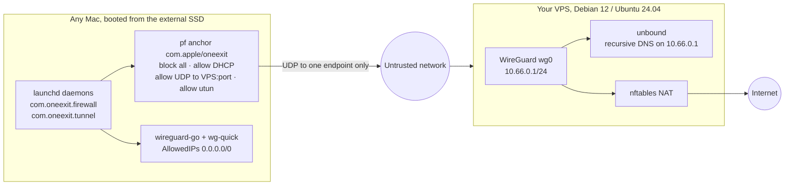

# oneexit

[](https://github.com/kvozianov/oneexit/actions/workflows/ci.yml)
[](LICENSE)


**A macOS that has exactly one exit.**

Boot any Mac from an external SSD into a macOS whose only route to the internet is a
WireGuard tunnel to your own VPS. Everything else is dropped by `pf` before login and
kept dropped by a watchdog.

```bash
# on a fresh Debian 12 / Ubuntu 24.04 VPS
git clone https://github.com/kvozianov/oneexit.git && sudo bash oneexit/server/install.sh

# on the Mac, booted from the external SSD
git clone https://github.com/kvozianov/oneexit.git && sudo bash oneexit/client/setup.sh --config mac.conf
oneexit leak-test
```

> **Scope.** oneexit is a set of shell scripts: a server installer, a client setup with
> two launchd daemons, a CLI and a leak test. It keeps one macOS installation on one
> disk from talking to the network except through your tunnel. It does not make you
> anonymous, it does not hide you from your VPS provider, and it has not had an
> independent security review. Read the [threat model](docs/threat-model.md) before
> you rely on it.

## Who this is for

- **Travel and untrusted Wi-Fi.** Hotel, café, airport and campus networks see one
  encrypted UDP flow to your server and nothing else: no DNS, no Bonjour, no IPv6, no
  direct connections from apps that ignore the VPN.
- **A separate, clean work environment.** The whole system lives on an SSD in your
  pocket. Plug it into your own Mac, a borrowed one or a shared one, boot from it, and
  you get the same macOS, the same tunnel and the same rules, without touching the
  internal disk.
- **People who do not want to trust a commercial VPN.** The exit is a 3-5 EUR per month
  server that you rent and control, with your own recursive DNS resolver on it.

## What it is not

- **Not an anonymity tool.** Your VPS provider sees all of your exit traffic, websites
  see your VPS address, and anything you sign in to knows who you are.
- **Not Tails.** Tails is amnesic and routes through Tor; oneexit is a normal,
  persistent macOS with a firewall and one tunnel. (Tails does not run on Apple silicon
  Macs, which is part of why this project exists.)
- **Not a tool for your everyday internal disk.** Setup refuses to run on an internal
  boot volume unless you insist with `--allow-internal-disk`.

See [docs/threat-model.md](docs/threat-model.md) for the full list.

## How it works



- **External SSD boot.** macOS is installed on an external SSD and oneexit is set up
  there. The internal disk of the Mac is not modified.
- **WireGuard to your VPS.** `wireguard-go` and `wg-quick` from Homebrew bring up a
  `utun` interface with `AllowedIPs = 0.0.0.0/0`, so all IPv4 traffic goes to your
  server, which NATs it to the internet with nftables.
- **pf kill switch, loaded at boot and watched.** A launchd daemon enables `pf` and loads
  the `com.apple/oneexit` anchor at boot, before anyone logs in, then checks every 5
  seconds that pf is still enabled and the anchor still has its rules, and reloads them
  if not. `/etc/pf.conf` is never edited. A second daemon keeps the tunnel up and
  restarts it when the handshake is older than 180 seconds or the network changes.
- **Recursive DNS on your VPS.** `unbound` on the server listens only on the tunnel
  address `10.66.0.1`, resolves names itself from the root servers with DNSSEC
  validation and QNAME minimisation, and forwards nothing to a third-party resolver.
- **A captive-portal window.** `oneexit portal` takes the tunnel down, switches DNS back to
  the network's own resolver and opens web and DNS traffic on the physical interface for
  3 minutes so you can click through a hotel or café login page; then the daemons lock the
  firewall, restore DNS and bring the tunnel back up by themselves.

## Install in 5 steps

You need: an external SSD (USB 3.1 Gen 2 or Thunderbolt), a Mac that can boot from it,
and a VPS with a public IPv4 address. Plan about an hour, most of it the macOS install.

### 1. Install macOS on the external SSD

Follow [docs/install-macos-external.md](docs/install-macos-external.md). It covers Apple
silicon, Intel Macs with a T2 chip and older Intel Macs, FileVault on the external
volume and a first-boot checklist (no iCloud, no analytics).

### 2. Rent a VPS and install the server

Any small KVM server with Debian 12 or Ubuntu 24.04 works; [docs/vps.md](docs/vps.md)
explains how to choose one. Log in over SSH, clone the repository and run the installer
(it is a few hundred lines of plain bash; read it first, and try `--dry-run`, which prints
every command and every file it would write without changing anything):

```bash
git clone https://github.com/kvozianov/oneexit.git
cd oneexit
sudo bash server/install.sh --dry-run
sudo bash server/install.sh
```

Options: `--port N` (default `51820`), `--endpoint HOST_OR_IP` (the address written into
client configs), `--peer NAME` (name of the first client, default `mac`), for example
`sudo bash server/install.sh --port 443 --peer travel-mac`. Re-running the installer keeps
existing keys and peers.

At the end the installer prints the first client config and the same config as a QR
code. The file is saved on the server as `/etc/wireguard/peers/mac.conf`.

### 3. Move the client config to the Mac

Boot the Mac from the external SSD. The kill switch is not active yet, so the Mac still
has normal network access. Copy the config over SSH:

```bash
scp root@YOUR_VPS_IP:/etc/wireguard/peers/mac.conf ./mac.conf
```

Or copy the text printed by the installer into a file named `mac.conf`. The QR code is
the same config in a form a phone camera can read; it is most useful for adding a phone
as a second peer (see [docs/vps.md](docs/vps.md)). The file contains a private key: keep
it out of cloud folders and delete your copy after setup.

### 4. Set up the Mac

Install [Homebrew](https://brew.sh) first (it also installs the Xcode command-line tools,
which include `git`):

```bash
/bin/bash -c "$(curl -fsSL https://raw.githubusercontent.com/Homebrew/install/HEAD/install.sh)"
```

Then:

```bash
git clone https://github.com/kvozianov/oneexit.git
cd oneexit
sudo client/setup.sh --config mac.conf --dry-run   # optional: see what it will do
sudo client/setup.sh --config mac.conf
```

`setup.sh`:

1. Checks that the running system is booted from an external disk and stops with an
   explanation if it is not (override with `--allow-internal-disk`).
2. Installs `wireguard-tools` and `wireguard-go` with Homebrew, installs the config as
   `/usr/local/etc/wireguard/wg0.conf` (root, mode 0600) and writes
   `/usr/local/etc/oneexit/config` with the server address and port. If the `Endpoint`
   is a hostname, it is resolved once now, because pf rules need an IP address.
3. Writes the pf anchor and the two launchd daemons, turns IPv6 off and sets DNS to
   `10.66.0.1` for every network service, and starts the daemons.
4. Prints the next steps.

From this point the Mac can reach the internet only through the tunnel.

### 5. Check it

```bash
oneexit status
oneexit leak-test
```

`status` shows whether pf is enabled, whether the anchor is loaded, the lock state, the
age of the last WireGuard handshake and your external IP as seen through the tunnel.
`leak-test` runs eight checks (pf and anchor, handshake, public IPv4, IPv6, DNS
resolver, direct interface, Bonjour sanity, and a manual WebRTC hint) and exits with
code 1 if any of them fails. `--json` prints machine-readable results.

## Daily use

Commands that change the firewall or the tunnel need root: run them with `sudo`.

| Command | What it does |
|---|---|
| `oneexit status` | pf enabled, anchor loaded, lock state, handshake age, external IP via the tunnel. |
| `oneexit lock` | Load the locked ruleset now (ends an `unlock` or `portal` window early). |
| `oneexit unlock [--minutes N]` | Allow all traffic for N minutes (default 10), then lock again automatically. |
| `oneexit portal [--minutes N]` | Captive-portal window: allow web and DNS on the physical interface for N minutes (default 3). |
| `oneexit up` | Bring the tunnel up. |
| `oneexit down` | Bring the tunnel down. The firewall stays locked, so the Mac is offline. |
| `oneexit leak-test` | Run the leak checks; exit code 1 on any `FAIL`. |
| `oneexit doctor` | Check the environment: boot disk, installed tools and versions, file permissions. |
| `oneexit logs` | Show the firewall and tunnel daemon logs (`/var/log/oneexit/`). |
| `oneexit uninstall` | Remove oneexit and restore the stock network configuration. |
| `oneexit version` | Print the version. |

Every subcommand that changes state accepts `--dry-run`.

**Captive portals.** Hotel and café networks often require a login page before they
pass any traffic, including the WireGuard handshake. With the firewall locked, that page
cannot load. Run `sudo oneexit portal`: the tunnel goes down (with the tunnel up, every
packet would be routed into it anyway), DNS switches to the network's own resolver, and
for the next 3 minutes the physical interface may also send TCP to ports 80 and 443 and
DNS to port 53, so the login page can open. When the window expires, the daemons load
the locked ruleset again, restore the tunnel DNS and bring the tunnel back up on their
own; you do not need to remember to close it. During the window, any app on the Mac can
reach the web directly, so open the portal page first and do nothing else until
`oneexit status` shows the tunnel up again. `sudo oneexit lock` closes the window early.

## What is blocked and what is allowed

These are the rules oneexit loads into the anchor (`render_pf` in
[client/lib/pf.sh](client/lib/pf.sh); see [docs/architecture.md](docs/architecture.md)
for the exact text). "Physical interfaces" means those listed in `PHYS_IFACES` in
`/usr/local/etc/oneexit/config` (default `en0`).

| Traffic | Locked (normal) | Why |
|---|---|---|
| DHCP on the physical interfaces (UDP 68 to 67 and back) | allowed | To get an address on the network at all |
| UDP to `VPS_IP:VPS_PORT` on the physical interfaces | allowed | The WireGuard tunnel itself |
| TCP, UDP and ICMP out through the tunnel (`utun*`), and their replies | allowed | Everything you actually use |
| ICMP in through the tunnel | allowed | Path MTU discovery and diagnostics |
| Any other IPv4 out of any interface | dropped | Kill switch: no traffic outside the tunnel, also while it is down |
| All IPv6 | dropped | v1 has no IPv6 in the tunnel; IPv6 is also turned off per network service |
| DNS to any server other than through the tunnel | dropped | The resolver is `10.66.0.1`, reachable only inside the tunnel |
| Bonjour / mDNS, and AirDrop beyond this Mac | dropped | No announcing your Mac's name and services to the local network |
| Local network access in both directions (printers, NAS, file and screen sharing) | dropped | One exit, no exceptions in v1 |
| Any traffic on interfaces not in `PHYS_IFACES` (for example a USB Ethernet adapter) | dropped | Only listed interfaces may carry the tunnel |

Loopback (`lo0`) is not filtered. The tunnel rules name the live `utunN` interface, which
the firewall daemon reads from `wg-quick` and re-renders when it changes; while the tunnel
is down the rules point at a placeholder that matches nothing. `oneexit portal` adds TCP
80/443 and UDP 53 on the physical interfaces for its window; `oneexit unlock` replaces the
ruleset with `pass all` for its window.

## Threat model in one table

| Protects against | Does not protect against |
|---|---|
| The local network or ISP seeing which sites you visit and which DNS names you look up | Your VPS provider: it sees all exit traffic and holds a copy of your client config |
| Traffic leaving outside the tunnel when the tunnel drops, before it is up, or when an app binds to the physical interface | Your Apple ID, iCloud and web accounts, which identify you no matter which IP you come from |
| IPv6 leaks | Browser fingerprinting |
| DNS leaks to the local network's resolver or any public resolver | Censorship that blocks WireGuard: the protocol is detectable and oneexit has no obfuscation |
| Bonjour / mDNS announcements and inbound connections from the local network | The first seconds of boot before the firewall daemon loads |
| Websites geolocating you by your real IP address | Someone with physical access to the SSD if FileVault is off |
| macOS or another program disabling pf or flushing the anchor (fixed within 5 s) | A compromised Mac (firmware, or malware with root) |

Details, the adversaries considered and the mitigations are in
[docs/threat-model.md](docs/threat-model.md).

## Comparison with existing tools

Each piece of oneexit exists elsewhere. The project combines them into one installable
path from an external disk to your own server, with tests.

| Tool | What it covers | What it leaves to you |
|---|---|---|
| Standalone pf kill-switch scripts for macOS (several small bash projects, 2023-2025) | pf rules that allow only the VPN endpoint, sometimes started by launchd | The server, DNS, an external-disk setup, a watchdog, a captive-portal path, a leak test, tests |
| [lesha19/KillSwitch](https://github.com/lesha19/KillSwitch) | A Swift app with a privileged helper, a pf anchor, a frequent watchdog, its own VPN client and a leak check | The server side; a larger codebase to audit than a few scripts |
| Server installers: [angristan/wireguard-install](https://github.com/angristan/wireguard-install), [Nyr/wireguard-install](https://github.com/Nyr/wireguard-install), [trailofbits/algo](https://github.com/trailofbits/algo), [wg-easy](https://github.com/wg-easy/wg-easy) | A WireGuard server in one command, peer management, some with a web UI | The client: no kill switch, nothing that runs before login on the Mac |

What oneexit adds by putting them together:

- the whole path, from installing macOS on an external disk to a configured server;
- a kill switch loaded by a boot-time daemon and kept in place by a 5-second watchdog,
  without editing `/etc/pf.conf`;
- recursive DNS with `unbound` on your own server instead of a third-party resolver;
- a timed captive-portal window and a timed `unlock` that both close themselves;
- a safeguard that refuses to install on an internal boot disk;
- a leak test with a non-zero exit code, usable in scripts;
- shellcheck, bats tests on macOS and Ubuntu, a real pf syntax check and a real server
  install in CI.

## Uninstall

On the Mac:

```bash
sudo oneexit uninstall
```

or, from the repository, `sudo client/uninstall.sh` (add `--keep-keys` to keep
`/usr/local/etc/wireguard/wg0.conf`). It unloads both daemons, removes the plists,
flushes the anchor, disables pf only if it was disabled before setup, sets IPv6 back to
automatic and DNS back to the network's default for every service, and removes the
installed files. Homebrew and the `wireguard-tools` / `wireguard-go` packages stay.

On the server, revoke the Mac's key so the old config stops working:

```bash
sudo server/peer.sh revoke mac
```

## Repository layout

```
server/
  install.sh            one-command WireGuard + unbound + nftables installer (root, Debian/Ubuntu)
  peer.sh               add | revoke | qr | list peers; prints a wg-quick client config
  lib/common.sh         logging, run()/dry-run, root check, OS detection
  lib/wg.sh             key generation, server/peer config rendering (pure functions)
  templates/            unbound.conf, nftables.conf, sysctl.conf templates
client/
  setup.sh              first-run setup of a fresh macOS on the external disk
  oneexit               the CLI (single bash file), installed to /usr/local/bin/oneexit
  uninstall.sh          restores the stock configuration
  lib/pf.sh             render_pf() pure function + anchor load/unload helpers
  lib/wgconf.sh         parse a wg-quick config (Endpoint, Address, DNS, PublicKey, ...)
  lib/common.sh         logging, run()/dry-run, root check, external-disk detection
  bin/oneexit-firewalld daemon: enable pf, load anchor, watchdog loop
  bin/oneexit-tunneld   daemon: wg-quick up, handshake watchdog, re-up on network change
  launchd/              com.oneexit.firewall.plist, com.oneexit.tunnel.plist
scripts/
  leak-test.sh          IPv4 / IPv6 / DNS resolver / direct-interface / Bonjour checks
docs/                   install-macos-external.md, vps.md, threat-model.md, faq.md, architecture.md
tests/                  bats-core tests: server/, client/, helpers/
.github/workflows/ci.yml
```

[docs/architecture.md](docs/architecture.md) is the interface contract: file paths,
flags, the exact pf rules and what each test covers.

## Testing

Every script that changes the system has a `--dry-run` mode that prints each command
and the full content of each file it would write, and works without root on either
OS. The tests are built on that, and on pure functions that render configs.

Locally (needs `bats-core` and `shellcheck`, for example `brew install bats-core shellcheck`):

```bash
shellcheck server/*.sh server/lib/*.sh client/*.sh client/lib/*.sh client/oneexit client/bin/* scripts/*.sh
bats tests/server tests/client    # or: bats -r tests
```

In CI ([.github/workflows/ci.yml](.github/workflows/ci.yml)):

- `shellcheck` on every script (Ubuntu);
- the bats suite on both Ubuntu and macOS runners: exact `render_pf` output, no `pass`
  rule on a physical interface other than the endpoint and DHCP, IPv6 blocked, the
  portal ruleset, config parsing, server and peer config rendering, peer address
  allocation, the internal-disk refusal, `plutil -lint` on the plists;
- on macOS, the generated rules are parsed by the real `pfctl -nvf`, and
  `client/setup.sh --dry-run` runs end to end;
- on Ubuntu, `server/install.sh` runs for real as root, and the job checks that `wg0`
  is up, the nftables ruleset contains the masquerade rule, unbound listens on
  `10.66.0.1:53`, and `peer.sh add` prints a valid client config.

## FAQ

Why not the WireGuard app from the App Store, why pf, what happens when the tunnel
drops, how to update macOS, and more: [docs/faq.md](docs/faq.md).

## License

[MIT](LICENSE)
