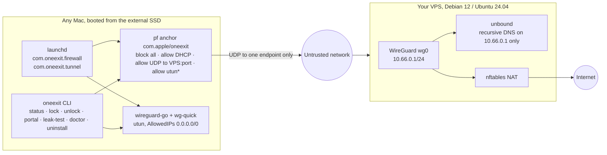

# Architecture

> Interface contract for everything in this repository. Scripts, tests and docs
> must agree with this file; change it first, then the code.

## One sentence

A Mac booted from the external SSD can reach the internet through exactly one
path: a WireGuard tunnel to the user's own VPS. Everything else is dropped by
`pf` before login and kept dropped by a watchdog.



## Repository layout

```
install.sh              bootstrap for the Mac: pinned release tarball, SHA-256 check, /usr/local/bin/oneexit link
server/
  install.sh            one-command WireGuard + unbound + nftables installer (root, Debian/Ubuntu)
  peer.sh               add | revoke | qr | list peers; prints a wg-quick client config
  lib/common.sh         logging, run()/dry-run, root check, OS detection
  lib/wg.sh             key generation, server/peer config rendering (pure functions)
  lib/templates.sh      render_unbound_conf / render_nftables_conf / render_sysctl_conf (pure functions)
client/
  setup.sh              first-run setup of a fresh macOS on the external disk
  oneexit               the CLI (single bash file), installed to /usr/local/bin/oneexit
  uninstall.sh          restores the stock configuration
  lib/init.sh           oneexit init: target parsing, ssh/tar command builders, the six steps
  lib/setup_steps.sh    the steps of setup.sh as functions (setup.sh and init call them)
  lib/privacy.sh        oneexit harden / unharden
  lib/pf.sh             render_pf() pure function + anchor load/unload helpers
  lib/wgconf.sh         parse a wg-quick config (Endpoint, Address, DNS, PublicKey, ...)
  lib/common.sh         logging, run()/dry-run, root check, external-disk detection
  bin/oneexit-firewalld daemon: enable pf, load anchor, watchdog loop
  bin/oneexit-tunneld   daemon: wg-quick up, handshake watchdog, re-up on network change
  launchd/com.oneexit.firewall.plist
  launchd/com.oneexit.tunnel.plist
scripts/
  leak-test.sh          IPv4 / IPv6 / DNS resolver / direct-interface / Bonjour checks; exit 1 on any FAIL
  release-checksum.sh   prints the SHA-256 of a release tag tarball for install.sh
docs/                   install-macos-external.md, vps.md, threat-model.md, faq.md, architecture.md
tests/
  server/*.bats  client/*.bats  helpers/           bats-core tests
.github/workflows/ci.yml
```

## Conventions (all scripts)

- `#!/usr/bin/env bash`, `set -euo pipefail`, shellcheck-clean with the repo `.shellcheckrc`.
- Every script that changes the system accepts `--dry-run`: print each command it
  would run, prefixed `[dry-run]`, and the full content of every file it would
  write, and exit 0 without touching anything. `--dry-run` must work on a machine
  without root, without `wg`, and on either OS (server scripts are tested in dry-run
  on macOS; client scripts in dry-run on Linux).
- Pure functions (rendering configs, parsing) live in `lib/*.sh`, take arguments,
  print to stdout, touch no files. Tests call them directly.
- `run()` from `lib/common.sh` executes or prints a command depending on `DRY_RUN`.
- `--help` on every script. Exit codes: 0 ok, 1 failure, 2 usage.
- No colours unless stdout is a TTY. Log lines: `==> step`, `ok: ...`, `warn: ...`, `error: ...`.
- No telemetry, no third-party downloads other than the OS package manager and Homebrew.
- English only. MIT. No mention of any code-generation tool anywhere.

## Server contract

- Interface `wg0`, subnet `10.66.0.0/24`, server `10.66.0.1`, peers from `10.66.0.2`.
- Listen port default `51820`, `--port N` overrides (documented use: 443 for restrictive networks).
- Files: `/etc/wireguard/wg0.conf` (0600), `/etc/wireguard/server.key`, `server.pub`,
  `/etc/wireguard/peers/<name>.conf` (client config, 0600), `/etc/wireguard/peers/<name>.pub`.
- `install.sh [--port N] [--endpoint HOST_OR_IP] [--peer NAME] [--dry-run]`:
  packages (`wireguard wireguard-tools unbound nftables qrencode dnsutils`), keys, `wg0.conf`,
  `net.ipv4.ip_forward=1` via `/etc/sysctl.d/99-oneexit.conf`, nftables NAT masquerade
  from `10.66.0.0/24` out of the default interface plus `input` accept for `udp dport <port>`,
  unbound listening on `10.66.0.1` port 53 for `10.66.0.0/24` only (recursive, no forwarders,
  DNSSEC on, `qname-minimisation: yes`). The nftables rules live in `/etc/nftables.d/oneexit.nft`
  and are loaded by an own oneshot unit `oneexit-nft.service` (the stock `nftables.service` and
  `/etc/nftables.conf` are left alone, so their `flush ruleset` never runs at boot);
  `systemctl enable --now wg-quick@wg0 unbound oneexit-nft`.
  Creates the first peer (`--peer`, default `mac`) and prints its config and a QR code.
  Idempotent: re-running keeps existing keys and peers.
- `peer.sh add NAME` prints the client config to stdout and saves it; `peer.sh qr NAME`;
  `peer.sh revoke NAME`; `peer.sh list`. Peer config:

```
[Interface]
PrivateKey = <peer private key>
Address = 10.66.0.N/32
DNS = 10.66.0.1

[Peer]
PublicKey = <server public key>
Endpoint = <endpoint>:<port>
AllowedIPs = 0.0.0.0/0
PersistentKeepalive = 25
```

  IPv6 is intentionally absent in v1 (no `::/0`, no v6 address).

## Client contract

- Requires macOS 13+, Homebrew. Installs `wireguard-tools` and `wireguard-go` with brew.
- Paths: config dir `/usr/local/etc/oneexit/` (`config` = `KEY=value` file with
  `VPS_IP`, `VPS_PORT`, `TUNNEL_DNS`, `WG_IFACE_CONF=/usr/local/etc/wireguard/wg0.conf`, `PHYS_IFACES`),
  `/usr/local/etc/wireguard/wg0.conf` (0600 root), anchor rules `/etc/pf.anchors/com.oneexit`,
  CLI `/usr/local/bin/oneexit`, daemons `/usr/local/libexec/oneexit/{oneexit-firewalld,oneexit-tunneld}`,
  libs `/usr/local/libexec/oneexit/lib/*.sh`, leak test `/usr/local/libexec/oneexit/leak-test.sh`, plists `/Library/LaunchDaemons/com.oneexit.{firewall,tunnel}.plist`,
  logs `/var/log/oneexit/{firewall,tunnel}.log`, state `/var/run/oneexit/` (unlock-until, portal-until).
- `setup.sh --config peer.conf [--allow-internal-disk] [--dry-run]`:
  1. Refuses to continue if the boot volume is internal (`diskutil info /` →
     `Device Location: Internal` or `Removable Media: Fixed` with non-USB/Thunderbolt protocol)
     unless `--allow-internal-disk`. Prints why.
  2. brew install; copies config; writes `oneexit` config from the peer conf (Endpoint → `VPS_IP`, `VPS_PORT`).
     If Endpoint is a hostname, resolves it once at setup and stores the IP (pf needs an IP).
  3. Renders pf anchor, writes plists, `networksetup -setv6off` for every network service,
     sets DNS of every network service to the tunnel DNS, loads daemons with `launchctl bootstrap system`.
  4. Prints next steps (`oneexit status`, `oneexit leak-test`).
- `render_pf VPS_IP VPS_PORT TUN_IFACE [PHYS_IFACES...]` (in `client/lib/pf.sh`) prints exactly:

```
# oneexit kill switch (generated; do not edit)
set block-policy drop
pass quick on lo0 all no state
block all
block quick inet6 all
pass out quick on { en0 en1 } proto udp from any to VPS_IP port VPS_PORT keep state
pass out quick on { en0 en1 } proto udp from port 68 to port 67 keep state
pass in quick on { en0 en1 } proto udp from port 67 to port 68 keep state
pass out quick on utun3 proto { tcp udp icmp } all keep state
pass in quick on utun3 proto icmp all keep state
```

  with `{ en0 en1 }` replaced by the given physical interfaces (default `en0`) and `utun3` by
  `TUN_IFACE`, the concrete tunnel interface. macOS pf has no reliable interface groups, so the
  daemon reads the live name from `/var/run/wireguard/wg0.name` (written by `wg-quick`), falling
  back to `wg show interfaces`, and uses the placeholder `utun99` while the tunnel is down: then
  only DHCP and the endpoint pass, which is the intended fail-closed state. The daemon re-renders
  and reloads whenever the text changes. `render_pf_portal VPS_IP VPS_PORT TUN_IFACE IFACES` adds
  `pass out quick on { ... } proto tcp from any to any port { 80 443 } keep state` and
  `pass out quick on { ... } proto udp from any to any port 53 keep state` before the utun lines.
  `render_pf_unlocked` prints `pass all` (used by `oneexit unlock`). `render_pf_failsafe` (config
  missing or invalid) is `block all` plus lo0 and DHCP.
- The anchor is evaluated only through the stock hook `anchor "com.apple/*"` in `/etc/pf.conf`.
  `setup.sh` refuses to install when the hook is missing; `oneexit-firewalld`, `oneexit doctor`,
  `oneexit status` and the leak test report its absence as a failure.
- Anchor: `/etc/pf.conf` is never edited. `oneexit-firewalld` runs `pfctl -E`,
  `pfctl -a com.apple/oneexit -f /etc/pf.anchors/com.oneexit` (through `pfctl_quiet`, which drops
  the "No ALTQ support" / "-f could flush rules" lines macOS prints on every call), and every 5 s checks
  `pfctl -s info` (Enabled), `pfctl -a com.apple/oneexit -s rules` (non-empty) and the live
  tunnel interface name; reloads if anything differs from what it last loaded.
  `/var/run/oneexit/portal-until` or `unlock-until` (epoch seconds) switch which ruleset is loaded;
  when expired, the daemon reloads the locked ruleset and restores the system DNS to `TUNNEL_DNS`.
- Portal and unlock windows. With `AllowedIPs = 0.0.0.0/0` every IPv4 packet is routed into `utun`,
  so opening ports in pf alone changes nothing. `oneexit portal` therefore: writes `portal-until`,
  sets the DNS of every network service to DHCP (`networksetup -setdnsservers SERVICE empty`),
  and `oneexit-tunneld` takes `wg0` down and keeps it down while `portal-until` is in the future;
  `oneexit-firewalld` loads the portal ruleset (TCP 80/443 and UDP 53 on physical interfaces,
  IPv6 still blocked). On expiry, or on `oneexit lock`, the daemons restore DNS to `TUNNEL_DNS`,
  reload the locked ruleset and bring `wg0` up again. `oneexit unlock` is the same with the
  unlocked ruleset (`pass all`) and the tunnel left as it is. `oneexit lock` ends either window early.
- `oneexit-tunneld`: `wg-quick up wg0`; every 10 s reads `wg show utunN latest-handshakes`, where
  `utunN` is the real device from `/var/run/wireguard/wg0.name` (trusted only if
  `/var/run/wireguard/utunN.sock` exists; `wg show wg0` does not work on macOS because wireguard-go's
  socket is named after the utun device, and only wg-quick translates the name);
  if the handshake is older than 180 s or the default route interface changed, `wg-quick down` + `up`.
  The tunnel plist sets `AbandonProcessGroup`: wireguard-go and wg-quick's route monitor run in the
  daemon's process group, and launchd would otherwise kill them whenever the daemon stops
  (`launchctl bootout`, `kickstart -k`, a crash). So the tunnel outlives a restart of its watchdog;
  `oneexit down`, `uninstall.sh` and a re-run of `setup.sh` take it down explicitly with `wg-quick down`.
- CLI `oneexit`:
  `status` (pf enabled, anchor loaded, lock state, handshake age, external IP via tunnel: the first
  answer from `https://api.ipify.org`, `https://ifconfig.me/ip`, `https://icanhazip.com`, not
  looked up while the tunnel is down outside an unlock window),
  `lock`, `unlock [--minutes N]` (default 10), `portal [--minutes N]` (default 3),
  `up`, `down`, `leak-test` (runs `scripts/leak-test.sh`), `doctor`, `logs`, `uninstall`, `version`.
  Every subcommand supports `--dry-run` where it changes state. Subcommands that need root
  (everything except `version` and `--help`) re-exec themselves with `sudo` when not root and not
  in dry-run, so the documented form is plain `oneexit status`.
- The installed `wg0.conf` differs from the peer config in two lines: the `DNS =` line is removed
  (wg-quick would otherwise save and restore DNS behind oneexit's back and undo portal windows) and
  `Endpoint` is pinned to `VPS_IP:VPS_PORT` (a hostname could not be resolved once DNS is pinned to
  the tunnel). `PHYS_IFACES=auto` (the default unless `--iface` is given) makes the firewall daemon
  re-read the physical `en*` ports on every pass. If the main ruleset loses the `com.apple/*` hook,
  the daemon reloads the stock `/etc/pf.conf` (at most every 30 s) and then its anchor. `wg show`
  is always called with the real `utunN` device (`wg_dev`), never `wg0`, because wireguard-go names
  its socket after the device. Daemons write `/var/run/oneexit/*.pid`; `/etc/newsyslog.d/oneexit.conf`
  rotates the logs at 1 MB and signals the daemons to reopen them.
- `setup.sh` is idempotent: running it again over an existing installation updates files in place,
  so `uninstall.sh --keep-keys` followed by `setup.sh` is the documented way to change the VPS.
- `uninstall.sh [--keep-keys] [--dry-run]` (`--keep-keys` keeps `/usr/local/etc/wireguard/wg0.conf`): `launchctl bootout`, remove plists, flush anchor
  (`pfctl -a com.apple/oneexit -F all`), `pfctl -d` only if pf was disabled before setup
  (recorded in `/usr/local/etc/oneexit/state`), `networksetup -setv6automatic` and
  `-setdnsservers <service> empty` for every service, remove files.

## Leak test contract (`scripts/leak-test.sh`)

Checks, each printed as `PASS`/`FAIL`/`SKIP` with a one-line reason; exit 1 if any FAIL:

1. pf enabled and anchor `com.apple/oneexit` has rules.
2. WireGuard handshake younger than 180 s.
3. Public IPv4 (first of `https://api.ipify.org`, `https://ifconfig.me/ip`, `https://icanhazip.com`,
   10 s timeout) equals `VPS_IP` or, if `--expect-ip X`, equals X. Without either, print it as INFO.
4. IPv6 connectivity must fail: FAIL if `curl -6 -m 5 https://api64.ipify.org` answers with an
   IPv6 address, or if `curl -6 -m 5 http://[2606:4700:4700::1111]/` (an address literal, no DNS)
   connects. A plain success of `curl -6 HOST` proves nothing: with IPv6 turned off macOS hands
   `curl -6` IPv4-mapped addresses (`::ffff:a.b.c.d`) and the request goes out over IPv4, through
   the tunnel, answering with the IPv4 exit address.
5. DNS resolver: `dig +short TXT whoami.cloudflare @1.1.1.1` is NOT used (would leak). Instead
   `dig +short whoami.akamai.net` through the system resolver returns the resolver's public IP;
   PASS if it equals `VPS_IP` (or `--expect-ip X`, the same expected exit as check 3); SKIP if
   `dig` is missing.
6. Direct interface: a TCP request bound to the default-route interface
   (`curl --interface en0 -m 5 http://1.1.1.1`) must time out (pf drops it). While the tunnel is
   up its `0/1` and `128/1` routes leave no route to 1.1.1.1 scoped to `en0`, so the kernel fails
   the request with "Network is unreachable" before pf sees it; the check then repeats the
   request against the on-link default gateway (`route -n get default`), which `en0` can still
   reach: a timeout is a PASS, a connection or a "Connection refused" (the packet left the Mac) is
   a FAIL.
7. Bonjour: `pfctl -a com.apple/oneexit -s rules` contains `block all` (sanity).
8. WebRTC: INFO line with a URL to check manually and what to look for.

`--json` prints the results as a JSON array. `--dry-run` prints the commands it would run.

## Tests

- `tests/server/*.bats`: `render_server_conf`, `render_peer_conf` content; `peer.sh add` in dry-run
  allocates `10.66.0.2` then `.3`; `install.sh --dry-run` lists every file it would write;
  nftables template has masquerade and the udp port; unbound template binds `10.66.0.1` only.
- `tests/client/*.bats`: `render_pf` exact output for `203.0.113.5 51820 utun3 en0`; multi-interface;
  no `pass` rule on physical interfaces other than the endpoint and DHCP; IPv6 blocked;
  `render_pf_portal` adds 80/443; `parse_wg_conf` on a sample; `setup.sh --dry-run` refuses an
  internal disk (fake `diskutil` on PATH) and proceeds with `--allow-internal-disk`;
  `leak-test.sh --dry-run`; `plutil -lint` on plists (skipped off macOS).
- Installing the server needs a clone of the repository (the scripts source `server/lib/*.sh`);
  the documented install is `git clone` + `sudo bash server/install.sh`, not `curl | bash`.
- CI (`.github/workflows/ci.yml`): `shellcheck` job (ubuntu); `bats` job on ubuntu and macos;
  macOS job also runs `pfctl -nvf` on `render_pf` output and `client/setup.sh --dry-run`;
  ubuntu `server-install` job runs `sudo server/install.sh --endpoint 203.0.113.5` for real and
  asserts `wg show wg0`, `nft list ruleset` contains masquerade, `ss -lun` shows 10.66.0.1:53,
  `peer.sh add laptop` prints a valid config.

## v0.2: one-command setup and environment hardening

### Why

Two gaps after v0.1. First, the install needed the user to work on the server by hand
(ssh, clone, run, copy the peer config back). Second, the tunnel hides *where the Mac
connects from*, but apps inside the sealed macOS could still learn where it *is*: Location
Services locate the Mac from nearby Wi-Fi networks (not from its IP), the automatic time
zone follows that location, the region in the locale names a country, and the DHCP client
announces the owner's computer name to every network it joins.

### `oneexit init` (client/oneexit, client/lib/init.sh)

One command on the Mac does everything:

```
sudo oneexit init --server root@203.0.113.5 [--ssh-key PATH] [--port 51820] [--peer NAME]
                  [--timezone Europe/Berlin] [--region DE] [--no-harden] [--allow-internal-disk] [--dry-run]
sudo oneexit init                      # interactive: asks for the server address and the options
sudo oneexit init --config mac.conf    # server already installed by hand: client setup only
```

Steps, each printed as `Step N/6: ...` with a one-line result:

1. Pre-flight: external disk check (as in setup.sh), Homebrew present, `ssh` present,
   server address parses as `[user@]host[:sshport]`.
2. Server reachability: `ssh -o BatchMode=yes -o ConnectTimeout=10 -o StrictHostKeyChecking=accept-new USER@HOST true`
   (`-o IdentitiesOnly=yes -i KEY` with `--ssh-key`, `-p SSHPORT` unless 22). ssh runs as
   `SUDO_USER` (`sudo -u USER -H`, with that user's agent socket from `launchctl asuser`),
   so the user's keys and `known_hosts` are used, not root's. If the login is not root,
   `sudo -n true` is checked and every remote command is prefixed with `sudo -n`. On failure
   print the exact ssh command to try by hand and the usual causes (wrong key, password-only
   login, passphrase without agent, provider firewall, changed host key, an active kill
   switch on a re-run). Then, unless `--timezone`, the server's zone:
   `ssh HOST 'timedatectl show -p Timezone --value'`.
3. Upload and install the server:
   `COPYFILE_DISABLE=1 tar --format ustar -C REPO -cf - server | ssh HOST 'rm -rf /opt/oneexit && mkdir -m 0700 /opt/oneexit && tar -C /opt/oneexit --no-same-owner -xf -'`
   (ustar: no macOS extended attributes; `mkdir` without `-p` fails instead of using a
   `/opt/oneexit` that another user created), then
   `ssh HOST 'bash /opt/oneexit/server/install.sh --endpoint HOST_IP --port PORT --peer NAME --timezone TZ'`
   with the server's output streamed to the terminal (stderr, `PrivateKey` lines hidden) and the peer config captured
   from `ssh HOST 'cat /etc/wireguard/peers/NAME.conf'` into a temporary file (mode 0600).
   `HOST_IP` is the address the Mac resolved for HOST (an IP literal is used as is). Re-running
   `init` against a server that already has oneexit keeps keys and peers (install.sh is
   idempotent) and adds the peer only if missing.
4. Client setup: the existing setup.sh steps, as a function call, not a subprocess.
5. Hardening: `oneexit harden` with the chosen time zone and region, unless `--no-harden`.
6. Verification: wait up to 30 s for the first handshake, then run the leak test with
   `--expect-ip HOST_IP` and print the summary and the next steps.

The interactive form asks only: server address, time zone (default: the server's own time
zone when it is not UTC, otherwise `Europe/Berlin`), region (default: derived from the time
zone's country when it is unambiguous, otherwise `DE`). Everything else uses defaults.
`--dry-run` prints the ssh and tar commands it would run and the setup/harden dry runs, with
no network access: ssh, tar and curl are never called, a hostname is not resolved
(`192.0.2.1` stands in for it), the server's time zone is assumed to be `Europe/Berlin`,
and a placeholder peer config with `Endpoint = HOST_IP:PORT` feeds the setup dry run.
`init` needs root except with `--dry-run` or `--help` and re-runs itself through `sudo`
after the arguments are checked. Without `--server` and `--config` it is interactive only
when stdin is a terminal; otherwise it exits 2 with the usage. `init --config FILE` skips
steps 2 and 3 (and still runs 1, 4, 5 and 6). The CLI finds `server/` next to its own
`client/` directory (the real path, symlinks followed), else in
`/usr/local/share/oneexit/<version>`; setup keeps a `/usr/local/bin/oneexit` symlink that
points at the same CLI instead of copying over it.

The server reports its time zone to clients: `peer.sh` writes `# oneexit-timezone = <tz>`
as a comment in every peer config (wg-quick ignores `#` lines). `init --config` and
`setup.sh --config` read it as the default for `--timezone`.

### `oneexit harden` and `oneexit unharden` (client/lib/privacy.sh)

Settings changed, all recorded first in `/usr/local/etc/oneexit/privacy-state` so that
`unharden` (and `uninstall`) restore the previous values exactly:

| What | How | Why |
|---|---|---|
| Location Services off, system-wide | `defaults write /var/db/locationd/Library/Preferences/ByHost/com.apple.locationd LocationServicesEnabled -int 0`, then `launchctl kickstart -k system/com.apple.locationd` | locationd finds the Mac's position from nearby Wi-Fi networks; the tunnel does not hide that |
| Automatic time zone off | `defaults write /Library/Preferences/com.apple.timezone.auto Active -bool false` | otherwise the time zone follows the real location |
| Time zone set | `systemsetup -settimezone TZ` (validated against `/usr/share/zoneinfo`) | apps and browsers report the system time zone; it should match the exit country |
| Region | `AppleLocale` in the global domain for the invoking user: keep the user's language, replace the region (`ru_KZ` → `ru_DE`); `AppleLanguages` entries lose a mismatching region (`ru-KZ` → `ru`) | the locale names a country; the language stays the user's choice |
| Computer name | `scutil --set ComputerName|HostName|LocalHostName` to a generic `Mac` / `Mac` (LocalHostName `Mac`) | the DHCP client sends the name to every network it joins; it often contains the owner's name |
| Chrome-family WebRTC | `defaults write com.google.Chrome WebRtcIPHandlingPolicy -string disable_non_proxied_udp` in `/Library/Preferences` (also `com.brave.Browser`, `com.microsoft.Edge`, `org.chromium.Chromium`) | stops WebRTC from offering the LAN address to sites |
| Firefox WebRTC | `/Applications/Firefox.app/Contents/Resources/distribution/policies.json` with `media.peerconnection.ice.default_address_only=true`, only if Firefox is installed and the file is absent | same |
| Lookup and Siri suggestions | user defaults `com.apple.lookup.shared LookupSuggestionsDisabled -bool true`, `com.apple.Safari UniversalSearchEnabled -bool false` | these send typed text with location hints to Apple |

Not changed: Apple ID, keyboard layouts, fonts, system language. The docs say why.
`harden` runs as root but applies user-domain defaults as `SUDO_USER` (`sudo -u USER defaults write ...`).
`--timezone` and `--region` are stored in `/usr/local/etc/oneexit/config` (`TIMEZONE`, `REGION`).

### Leak test additions (scripts/leak-test.sh)

9. Time zone: `systemsetup -gettimezone` equals `TIMEZONE` from the config (SKIP if unset)
   and `com.apple.timezone.auto Active` is false.
10. Location Services: the locationd preference is 0 (FAIL if 1 or missing).
11. Computer name: none of ComputerName / HostName / LocalHostName contains the invoking
    user's full name or account name (from `id -F` / `id -un`).
12. Region: `AppleLocale`'s region equals `REGION` (SKIP if unset).

`--json` includes them. `oneexit status` shows a one-word `privacy: hardened|partial|off` line.

### Server additions

- `install.sh --timezone TZ` (default: the server's current zone from `timedatectl show -p Timezone --value`
  or `/etc/timezone`, falling back to `Etc/UTC`) is written to `/etc/wireguard/oneexit.env`
  as `TIMEZONE=`; `peer.sh` emits `# oneexit-timezone = TZ` into peer configs.
- unbound answers NXDOMAIN for Apple's Wi-Fi positioning endpoint as defence in depth:
  `local-zone: "gs-loc.apple.com." always_nxdomain` (installer flag `--no-dns-blocklist`
  skips it). Documented; Maps and Find My use other hosts.

### Root `install.sh` (repository root)

A self-contained bootstrap for the Mac so that the whole product is one line in the README:

```bash
/bin/bash -c "$(curl -fsSL https://raw.githubusercontent.com/kvozianov/oneexit/main/install.sh)"
```

It downloads the release tarball for the pinned version (`ONEEXIT_VERSION` inside the
script; `https://github.com/kvozianov/oneexit/archive/refs/tags/vVERSION.tar.gz`, with
curl, as the invoking user, into a temporary directory), checks its SHA-256
(`shasum -a 256` on macOS, `sha256sum` on Linux) against the value embedded in the script
(`ONEEXIT_SHA256`), unpacks it to `/usr/local/share/oneexit/<version>`, links
`/usr/local/bin/oneexit` to that copy's `client/oneexit`, and prints
`sudo oneexit init --server root@YOUR_VPS` as the next step. It never runs `init` itself.
Without a checksum (an empty `ONEEXIT_SHA256`, or `--version X` other than the pinned one
without `--sha256 HEX`) it refuses before downloading, unless `--insecure-skip-checksum`.
Only the writes to `/usr/local` run as root, each through `sudo` (the script usually comes
from `bash -c`, so there is no file to re-run with sudo). `--version X`, `--sha256 HEX`,
`--insecure-skip-checksum`, `--dry-run` (no network, no sudo, prints the URL, the checksum
decision and the paths; works on macOS and Linux) and `--help` are accepted. `scripts/release-checksum.sh VERSION` prints the checksum to paste into the
script after the tag is pushed; the README keeps the `git clone` path as the audited alternative.

### Tests

- bats (`tests/client/init.bats`, `tests/client/bootstrap.bats`, `tests/client/privacy.bats`):
  `init` argument parsing and `[user@]host[:port]` splitting; the dry run prints the
  ssh/tar commands in order and stops before any network call; `--config` path reads the
  time zone comment; `harden --dry-run` prints every defaults/systemsetup/scutil command and
  the state file content; region rewriting (`ru_KZ`+`DE` → `ru_DE`, `en-KZ` → `en`); time zone
  validation rejects `Mars/Olympus`; `unharden --dry-run` restores from a fixture state file;
  the four new leak-test checks with stubs (`systemsetup`, `defaults`, `scutil`, `id`); root
  `install.sh --dry-run` on both OSes; server `--timezone` in `oneexit.env` and the peer
  comment; unbound template contains the local-zone unless `--no-dns-blocklist`.
- integration.sh: `peer.sh add` output contains `# oneexit-timezone =`; `dig @10.66.0.1 gs-loc.apple.com` → NXDOMAIN.
