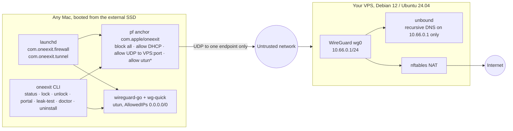

# Architecture

> Interface contract for everything in this repository. Scripts, tests and docs
> must agree with this file; change it first, then the code.

## One sentence

A Mac booted from the external SSD can reach the internet through exactly one
path: a WireGuard tunnel to the user's own VPS. Everything else is dropped by
`pf` before login and kept dropped by a watchdog.



## Repository layout

```
server/
  install.sh            one-command WireGuard + unbound + nftables installer (root, Debian/Ubuntu)
  peer.sh               add | revoke | qr | list peers; prints a wg-quick client config
  lib/common.sh         logging, run()/dry-run, root check, OS detection
  lib/wg.sh             key generation, server/peer config rendering (pure functions)
  lib/templates.sh      render_unbound_conf / render_nftables_conf / render_sysctl_conf (pure functions)
client/
  setup.sh              first-run setup of a fresh macOS on the external disk
  oneexit               the CLI (single bash file), installed to /usr/local/bin/oneexit
  uninstall.sh          restores the stock configuration
  lib/pf.sh             render_pf() pure function + anchor load/unload helpers
  lib/wgconf.sh         parse a wg-quick config (Endpoint, Address, DNS, PublicKey, ...)
  lib/common.sh         logging, run()/dry-run, root check, external-disk detection
  bin/oneexit-firewalld daemon: enable pf, load anchor, watchdog loop
  bin/oneexit-tunneld   daemon: wg-quick up, handshake watchdog, re-up on network change
  launchd/com.oneexit.firewall.plist
  launchd/com.oneexit.tunnel.plist
scripts/
  leak-test.sh          IPv4 / IPv6 / DNS resolver / direct-interface / Bonjour checks; exit 1 on any FAIL
docs/                   install-macos-external.md, vps.md, threat-model.md, faq.md, architecture.md
tests/
  server/*.bats  client/*.bats  helpers/           bats-core tests
.github/workflows/ci.yml
```

## Conventions (all scripts)

- `#!/usr/bin/env bash`, `set -euo pipefail`, shellcheck-clean with the repo `.shellcheckrc`.
- Every script that changes the system accepts `--dry-run`: print each command it
  would run, prefixed `[dry-run]`, and the full content of every file it would
  write, and exit 0 without touching anything. `--dry-run` must work on a machine
  without root, without `wg`, and on either OS (server scripts are tested in dry-run
  on macOS; client scripts in dry-run on Linux).
- Pure functions (rendering configs, parsing) live in `lib/*.sh`, take arguments,
  print to stdout, touch no files. Tests call them directly.
- `run()` from `lib/common.sh` executes or prints a command depending on `DRY_RUN`.
- `--help` on every script. Exit codes: 0 ok, 1 failure, 2 usage.
- No colours unless stdout is a TTY. Log lines: `==> step`, `ok: ...`, `warn: ...`, `error: ...`.
- No telemetry, no third-party downloads other than the OS package manager and Homebrew.
- English only. MIT. No mention of any code-generation tool anywhere.

## Server contract

- Interface `wg0`, subnet `10.66.0.0/24`, server `10.66.0.1`, peers from `10.66.0.2`.
- Listen port default `51820`, `--port N` overrides (documented use: 443 for restrictive networks).
- Files: `/etc/wireguard/wg0.conf` (0600), `/etc/wireguard/server.key`, `server.pub`,
  `/etc/wireguard/peers/<name>.conf` (client config, 0600), `/etc/wireguard/peers/<name>.pub`.
- `install.sh [--port N] [--endpoint HOST_OR_IP] [--peer NAME] [--dry-run]`:
  packages (`wireguard wireguard-tools unbound nftables qrencode`), keys, `wg0.conf`,
  `net.ipv4.ip_forward=1` via `/etc/sysctl.d/99-oneexit.conf`, nftables NAT masquerade
  from `10.66.0.0/24` out of the default interface plus `input` accept for `udp dport <port>`,
  unbound listening on `10.66.0.1` port 53 for `10.66.0.0/24` only (recursive, no forwarders,
  DNSSEC on, `qname-minimisation: yes`), `systemctl enable --now wg-quick@wg0 unbound nftables`.
  Creates the first peer (`--peer`, default `mac`) and prints its config and a QR code.
  Idempotent: re-running keeps existing keys and peers.
- `peer.sh add NAME` prints the client config to stdout and saves it; `peer.sh qr NAME`;
  `peer.sh revoke NAME`; `peer.sh list`. Peer config:

```
[Interface]
PrivateKey = <peer private key>
Address = 10.66.0.N/32
DNS = 10.66.0.1

[Peer]
PublicKey = <server public key>
Endpoint = <endpoint>:<port>
AllowedIPs = 0.0.0.0/0
PersistentKeepalive = 25
```

  IPv6 is intentionally absent in v1 (no `::/0`, no v6 address).

## Client contract

- Requires macOS 13+, Homebrew. Installs `wireguard-tools` and `wireguard-go` with brew.
- Paths: config dir `/usr/local/etc/oneexit/` (`config` = `KEY=value` file with
  `VPS_IP`, `VPS_PORT`, `TUNNEL_DNS`, `WG_IFACE_CONF=/usr/local/etc/wireguard/wg0.conf`, `PHYS_IFACES`),
  `/usr/local/etc/wireguard/wg0.conf` (0600 root), anchor rules `/etc/pf.anchors/com.oneexit`,
  CLI `/usr/local/bin/oneexit`, daemons `/usr/local/libexec/oneexit/{oneexit-firewalld,oneexit-tunneld}`,
  libs `/usr/local/libexec/oneexit/lib/*.sh`, leak test `/usr/local/libexec/oneexit/leak-test.sh`, plists `/Library/LaunchDaemons/com.oneexit.{firewall,tunnel}.plist`,
  logs `/var/log/oneexit/{firewall,tunnel}.log`, state `/var/run/oneexit/` (unlock-until, portal-until).
- `setup.sh --config peer.conf [--allow-internal-disk] [--dry-run]`:
  1. Refuses to continue if the boot volume is internal (`diskutil info /` →
     `Device Location: Internal` or `Removable Media: Fixed` with non-USB/Thunderbolt protocol)
     unless `--allow-internal-disk`. Prints why.
  2. brew install; copies config; writes `oneexit` config from the peer conf (Endpoint → `VPS_IP`, `VPS_PORT`).
     If Endpoint is a hostname, resolves it once at setup and stores the IP (pf needs an IP).
  3. Renders pf anchor, writes plists, `networksetup -setv6off` for every network service,
     sets DNS of every network service to the tunnel DNS, loads daemons with `launchctl bootstrap system`.
  4. Prints next steps (`oneexit status`, `oneexit leak-test`).
- `render_pf VPS_IP VPS_PORT TUN_IFACE [PHYS_IFACES...]` (in `client/lib/pf.sh`) prints exactly:

```
# oneexit kill switch (generated; do not edit)
set block-policy drop
pass quick on lo0 all no state
block all
block quick inet6 all
pass out quick on { en0 en1 } proto udp from any to VPS_IP port VPS_PORT keep state
pass out quick on { en0 en1 } proto udp from port 68 to port 67 keep state
pass in quick on { en0 en1 } proto udp from port 67 to port 68 keep state
pass out quick on utun3 proto { tcp udp icmp } all keep state
pass in quick on utun3 proto icmp all keep state
```

  with `{ en0 en1 }` replaced by the given physical interfaces (default `en0`) and `utun3` by
  `TUN_IFACE`, the concrete tunnel interface. macOS pf has no reliable interface groups, so the
  daemon reads the live name from `/var/run/wireguard/wg0.name` (written by `wg-quick`), falling
  back to `wg show interfaces`, and uses the placeholder `utun99` while the tunnel is down: then
  only DHCP and the endpoint pass, which is the intended fail-closed state. The daemon re-renders
  and reloads whenever the text changes. `render_pf_portal VPS_IP VPS_PORT TUN_IFACE IFACES` adds
  `pass out quick on { ... } proto tcp from any to any port { 80 443 } keep state` and
  `pass out quick on { ... } proto udp from any to any port 53 keep state` before the utun lines.
  `render_pf_unlocked` prints `pass all` (used by `oneexit unlock`). `render_pf_failsafe` (config
  missing or invalid) is `block all` plus lo0 and DHCP.
- The anchor is evaluated only through the stock hook `anchor "com.apple/*"` in `/etc/pf.conf`.
  `setup.sh` refuses to install when the hook is missing; `oneexit-firewalld`, `oneexit doctor`,
  `oneexit status` and the leak test report its absence as a failure.
- Anchor: `/etc/pf.conf` is never edited. `oneexit-firewalld` runs `pfctl -E`,
  `pfctl -a com.apple/oneexit -f /etc/pf.anchors/com.oneexit`, and every 5 s checks
  `pfctl -s info` (Enabled), `pfctl -a com.apple/oneexit -s rules` (non-empty) and the live
  tunnel interface name; reloads if anything differs from what it last loaded.
  `/var/run/oneexit/portal-until` or `unlock-until` (epoch seconds) switch which ruleset is loaded;
  when expired, the daemon reloads the locked ruleset and restores the system DNS to `TUNNEL_DNS`.
- Portal and unlock windows. With `AllowedIPs = 0.0.0.0/0` every IPv4 packet is routed into `utun`,
  so opening ports in pf alone changes nothing. `oneexit portal` therefore: writes `portal-until`,
  sets the DNS of every network service to DHCP (`networksetup -setdnsservers SERVICE empty`),
  and `oneexit-tunneld` takes `wg0` down and keeps it down while `portal-until` is in the future;
  `oneexit-firewalld` loads the portal ruleset (TCP 80/443 and UDP 53 on physical interfaces,
  IPv6 still blocked). On expiry, or on `oneexit lock`, the daemons restore DNS to `TUNNEL_DNS`,
  reload the locked ruleset and bring `wg0` up again. `oneexit unlock` is the same with the
  unlocked ruleset (`pass all`) and the tunnel left as it is. `oneexit lock` ends either window early.
- `oneexit-tunneld`: `wg-quick up wg0`; every 10 s reads `wg show wg0 latest-handshakes`;
  if the handshake is older than 180 s or the default route interface changed, `wg-quick down` + `up`.
- CLI `oneexit`:
  `status` (pf enabled, anchor loaded, lock state, handshake age, external IP via tunnel),
  `lock`, `unlock [--minutes N]` (default 10), `portal [--minutes N]` (default 3),
  `up`, `down`, `leak-test` (runs `scripts/leak-test.sh`), `doctor`, `logs`, `uninstall`, `version`.
  Every subcommand supports `--dry-run` where it changes state. Subcommands that need root
  (everything except `version` and `--help`) re-exec themselves with `sudo` when not root and not
  in dry-run, so the documented form is plain `oneexit status`.
- `setup.sh` is idempotent: running it again over an existing installation updates files in place,
  so `uninstall.sh --keep-keys` followed by `setup.sh` is the documented way to change the VPS.
- `uninstall.sh [--keep-keys] [--dry-run]` (`--keep-keys` keeps `/usr/local/etc/wireguard/wg0.conf`): `launchctl bootout`, remove plists, flush anchor
  (`pfctl -a com.apple/oneexit -F all`), `pfctl -d` only if pf was disabled before setup
  (recorded in `/usr/local/etc/oneexit/state`), `networksetup -setv6automatic` and
  `-setdnsservers <service> empty` for every service, remove files.

## Leak test contract (`scripts/leak-test.sh`)

Checks, each printed as `PASS`/`FAIL`/`SKIP` with a one-line reason; exit 1 if any FAIL:

1. pf enabled and anchor `com.apple/oneexit` has rules.
2. WireGuard handshake younger than 180 s.
3. Public IPv4 (first of `https://api.ipify.org`, `https://ifconfig.me/ip`, `https://icanhazip.com`,
   10 s timeout) equals `VPS_IP` or, if `--expect-ip X`, equals X. Without either, print it as INFO.
4. IPv6 connectivity must fail (`curl -6 -m 5 https://api64.ipify.org` → FAIL if it succeeds).
5. DNS resolver: `dig +short TXT whoami.cloudflare @1.1.1.1` is NOT used (would leak). Instead
   `dig +short whoami.akamai.net` through the system resolver returns the resolver's public IP;
   PASS if it equals `VPS_IP`; SKIP if `dig` is missing.
6. Direct interface: `curl --interface en0 -m 5 http://1.1.1.1` must fail.
7. Bonjour: `pfctl -a com.apple/oneexit -s rules` contains `block all` (sanity).
8. WebRTC: INFO line with a URL to check manually and what to look for.

`--json` prints the results as a JSON array. `--dry-run` prints the commands it would run.

## Tests

- `tests/server/*.bats`: `render_server_conf`, `render_peer_conf` content; `peer.sh add` in dry-run
  allocates `10.66.0.2` then `.3`; `install.sh --dry-run` lists every file it would write;
  nftables template has masquerade and the udp port; unbound template binds `10.66.0.1` only.
- `tests/client/*.bats`: `render_pf` exact output for `203.0.113.5 51820 utun3 en0`; multi-interface;
  no `pass` rule on physical interfaces other than the endpoint and DHCP; IPv6 blocked;
  `render_pf_portal` adds 80/443; `parse_wg_conf` on a sample; `setup.sh --dry-run` refuses an
  internal disk (fake `diskutil` on PATH) and proceeds with `--allow-internal-disk`;
  `leak-test.sh --dry-run`; `plutil -lint` on plists (skipped off macOS).
- Installing the server needs a clone of the repository (the scripts source `server/lib/*.sh`);
  the documented install is `git clone` + `sudo bash server/install.sh`, not `curl | bash`.
- CI (`.github/workflows/ci.yml`): `shellcheck` job (ubuntu); `bats` job on ubuntu and macos;
  macOS job also runs `pfctl -nvf` on `render_pf` output and `client/setup.sh --dry-run`;
  ubuntu `server-install` job runs `sudo server/install.sh --endpoint 203.0.113.5` for real and
  asserts `wg show wg0`, `nft list ruleset` contains masquerade, `ss -lun` shows 10.66.0.1:53,
  `peer.sh add laptop` prints a valid config.
